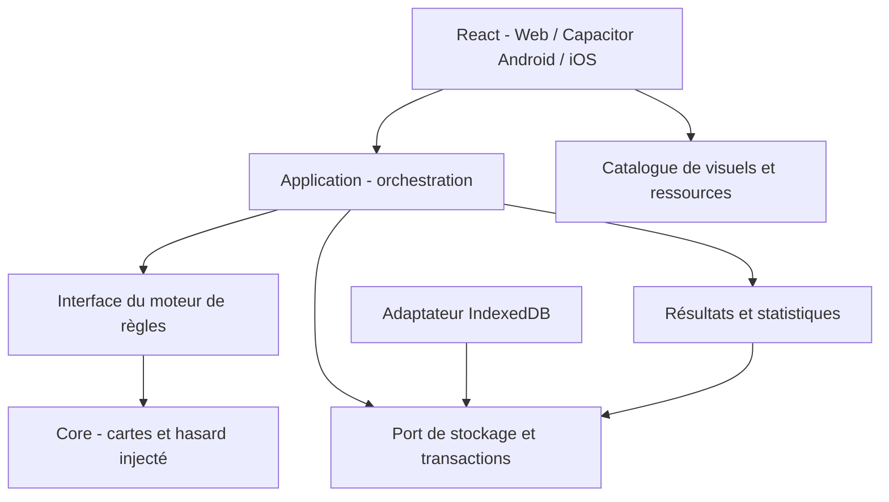

# Architecture Spine — CardForge

## Design Paradigm

**Architecture hexagonale légère + cœur fonctionnel déterministe.** Le domaine (cartes et règles de chaque jeu) est un noyau TypeScript sans effet de bord. La couche applicative orchestre les actions métier et dépend de ports de persistance. Les adaptateurs IndexedDB et les vues React/Capacitor dépendent du domaine et de l'application, jamais l'inverse.



## Invariants & Rules

### AD-01 — Web React + enveloppe mobile Capacitor [ADOPTED]
- **Binds:** interface, build, plugins de plateforme, livraison.
- **Prevents:** divergence du comportement métier entre trois applications.
- **Rule:** le Web React/Vite est la base fonctionnelle ; Android et iOS réutilisent les mêmes modules TypeScript et l'interface via Capacitor. Tout accès natif passe par un adaptateur. Pas de réécriture des moteurs pour mobile.

### AD-02 — Socle technique partagé, moteur autonome par jeu [ADOPTED]
- **Binds:** `src/core`, futurs `src/games/<game-id>`, contrat moteur.
- **Prevents:** moteur universel rempli d'exceptions ou logique partagée modifiant un jeu existant.
- **Rule:** **décision confirmée par le porteur le 23 novembre 2026 : option B.** Chaque jeu expose un moteur de règles **indépendant** via un **contrat commun minimal et typé** (création, actions légales, transition, issue, validation de l'état). Les actions, phases, valeurs contextuelles et conditions de victoire restent internes à chaque moteur ; le socle ne porte aucune règle spécifique à un jeu. Aucun moteur universel à exceptions ni duplication des services transversaux par jeu.

### AD-03 — Transitions pures, états immuables et hasard maîtrisé [ADOPTED]
- **Binds:** tous moteurs, application, sauvegardes, tests.
- **Prevents:** résultats dépendant de l'UI, mutation accidentelle ou nouvelle pioche au chargement.
- **Rule:** `transition(state, action)` est pure et ne modifie jamais `state` ; état+action identiques donnent résultat identique. L'ordre initial de la pioche est déterminé à la création et inclus dans l'état sérialisé. Toute erreur métier laisse le dernier état valide inchangé.

### AD-04 — Port de stockage, adaptateur IndexedDB initial [ADOPTED]
- **Binds:** sauvegardes, préférences, statistiques, Web et WebViews.
- **Prevents:** dépendance du domaine à IndexedDB et implémentations contradictoires.
- **Rule:** **décision confirmée par le porteur le 23 novembre 2026 : option B.** IndexedDB est l'adaptateur transactionnel retenu pour le **MVP Web/PWA**, derrière un port de persistance. Les moteurs ne dépendent ni du navigateur ni du stockage. Sauvegarde, clôture/résultat et statistiques associées doivent être écrites atomiquement dans une transaction couvrant les magasins concernés ; une transaction échouée n'est pas présentée comme enregistrée. Sur Android/iOS, la durabilité d'IndexedDB en WebView doit être démontrée par tests avant adoption de ce même adaptateur ; une alternative native restera possible sans changement de moteur.

### AD-05 — Carte logique indépendante du catalogue graphique [ADOPTED]
- **Binds:** données des cartes, visuels, mapping des factions.
- **Prevents:** changement des règles par une illustration ou une localisation.
- **Rule:** **décision confirmée par le porteur le 23 novembre 2026 : option B.** Chaque **carte physique** possède un identifiant stable et unique **au sein de la partie**, y compris chacun des deux Jokers ; son identité persiste entre toutes les zones (pioche, main, plateau, défausse, etc.) et les sauvegardes. Enseigne/rang d'origine sont distincts de la **valeur ou du rôle calculé par le moteur propre au jeu** (notamment le Joker). Noms, illustrations, factions affichées, sons et animations sont résolus en présentation, sans incidence sur le métier. La quantité et les zones de cartes attendues sont contrôlées selon les règles du jeu.

### AD-06 — Pyramide de tests liée aux règles [ADOPTED]
- **Binds:** moteurs, stockage, application, CI, diffusion.
- **Prevents:** jeu visuellement fonctionnel mais non conforme, régressions de reprise.
- **Rule:** scénarios déterministes pour chaque règle du référentiel, tests d'intégration des transactions/migrations, parcours de bout en bout sur Web et validation dédiée Android/iOS avant sortie. Les contrôles obligatoires échoués bloquent l'intégration/release ; une matrice non exécutée n'est pas une preuve de conformité.

### AD-07 — Ressources embarquées, répertoires par jeu [ADOPTED]
- **Binds:** assets, build, catalogue et mode hors ligne.
- **Prevents:** dépendance à un téléchargement de packs pour jouer au MVP.
- **Rule:** illustrations, sons, polices et textes nécessaires aux jeux livrés sont inclus dans la distribution Web/PWA et dans les paquets natifs. Pas de téléchargement de packs ni CDN obligatoire en V1. Regrouper les ressources par identifiant de jeu pour l'évolution future.

### AD-08 — PWA Web hors ligne, ressources mobiles embarquées [ADOPTED]
- **Binds:** service worker, cycle de vie, build Web, mobile.
- **Prevents:** promesse « hors ligne » fondée sur un cache opportuniste.
- **Rule:** le Web fournit un manifeste et un service worker à cache versionné ; ne déclarer le jeu prêt hors ligne qu'une fois toutes ses ressources requises disponibles. Android/iOS utilisent les ressources du paquet Capacitor. Cache de ressources et données persistées restent séparés ; une mise à jour des assets ne purge jamais volontairement les parties.

### AD-09 — Sauvegardes versionnées et migrations sans altération des règles [ADOPTED]
- **Binds:** enveloppes de sauvegarde, migrations, restauration.
- **Prevents:** destruction des parties lors d'évolution du code ou conversion silencieuse d'une règle.
- **Rule:** toute sauvegarde identifie au moins jeu, partie, version du format, version de règles et état complet ordonné. Une migration validée s'effectue transactionnellement avant remplacement de l'ancienne donnée. Une sauvegarde inconnue/incompatible est conservée et ne peut pas être reprise comme une partie valide. Version de l'application ≠ version de format ≠ version des règles.

### AD-10 — Orchestration unique hors React [ADOPTED]
- **Binds:** interface, transactions, compteurs, moteur.
- **Prevents:** actions validées différemment selon écran, double comptage, rendu d'un état non sauvegardé comme durable.
- **Rule:** le point d'entrée d'une action est un service applicatif unique par session ; il sérialise les commandes, appelle le moteur pur, persiste les changements et résultats une seule fois, puis notifie l'UI de l'état et du statut de persistance. L'interface ne calcule aucune victoire/défaite ; les événements terminaux possèdent un identifiant unique de partie/résultat pour une écriture idempotente.

### AD-11 — Erreurs catégorisées et récupération non destructive [ADOPTED]
- **Binds:** application, stockage, migrations et interface.
- **Prevents:** perte silencieuse des données, reprise d'état corrompu et confirmation mensongère.
- **Rule:** distinguer action invalide, écriture impossible, sauvegarde corrompue et migration incompatible. Ne jamais effacer automatiquement une sauvegarde invalide, ni afficher « Enregistré » avant confirmation de persistance. En cas d'échec, conserver si possible l'état courant en mémoire et permettre une reprise contrôlée ; ne promettre aucune récupération si le stockage physique a été supprimé.

### AD-12 — Builds mobiles en CI GitHub Actions [ADOPTED]
- **Binds:** workflows, runners, signatures, publication.
- **Prevents:** dépendance à un IDE local ou confusion entre build, signature et distribution.
- **Rule:** CI Web d'abord, puis Android sur runner compatible et iOS sur runner macOS compatible. Les secrets de signature ne sont jamais commités ; publication distincte du build technique, déclenchée et autorisée explicitement. Les contraintes actuelles GitHub/Capacitor/Apple restent à confirmer avant d'implémenter ces pipelines.

## Consistency Conventions

| Concern | Convention contraignante |
| --- | --- |
| Identités | `gameId` stable, `sessionId` distinct, `cardId` physique stable et unique au sein de la partie (jokers distincts inclus) ; résultats dédupliqués par identifiant stable de partie. |
| Contrat moteur | Création, actions légales, transition pure, issue et validation d'état forment la surface commune minimale ; formes et noms TypeScript à fixer avec Amelia sans faire entrer les règles spécifiques dans le socle. |
| Résultats | `in-progress / win / loss / abandoned` ; abandon = commande confirmée, jamais fermeture d'onglet. |
| Persistance | Une sauvegarde active par `gameId` ; IndexedDB transactionnel pour Web/PWA ; données ordonnées et versionnées, statistiques indépendantes logiquement mais écrites atomiquement avec les résultats concernés. |
| Écriture | Transitions métier synchrones ; persistance asynchrone confirmée ; commandes sérialisées, interdiction de double exécution ou écrasement concurrent. |
| Intégrité | Valider schéma, version et invariants avant restauration ; ne pas détruire une sauvegarde inconnue. |
| Cartes | Modèle neutre, catalogue visuel résolu côté UI ; aucune décision mécanique issue du thème. |
| Erreurs | Résultat typé du moteur, erreur technique catégorisée dans la couche applicative ; UI localisée, sans données sensibles dans les logs. |
| Accessibilité | Tactile et clavier, valeurs visibles indépendantes des couleurs, prise en charge de la réduction des animations. |

## Stack — relevé du dépôt, 22 novembre 2026

| Élément | État |
| --- | --- |
| React / react-dom | `^19.0.0` déclaré dans `package.json` |
| TypeScript | `~5.7.3` déclaré |
| Vite | `^6.0.0` déclaré |
| Tests | `node --test tests/*.test.mjs` présent ; test existant surtout textuel |
| Capacitor | **Adopté architecturalement, non installé ni version figée** |
| IndexedDB | API native Web/WebView, adaptateur à développer |
| PWA | Service worker et manifeste à développer |
| GitHub Actions | Pipelines mobiles à étudier et à configurer |

Les versions ci-dessus sont celles **déclarées par le dépôt**, pas un audit externe de leurs dernières versions. Aucune recherche Web avancée n'a été déclenchée pour ce document.

## Structural Seed

```text
src/
  core/            # cartes et tirage neutres — cards.ts existe
  games/           # un moteur pur par jeu — dossier à créer
  application/     # commandes, sessions, résultat, orchestration — à créer
  ports/           # contrats de persistance et de cycle de vie — à créer
  adapters/        # IndexedDB, puis capacités de plateforme — à créer
  presentation/    # mapping illustrations et univers visuels — à créer
  App.tsx          # catalogue React actuellement existant
tests/             # scénarios métier, intégration, parcours — à étendre
public/            # assets par jeu, manifeste et ressources Web — à organiser
.github/workflows/ # CI existante à inventorier avant adaptation
```

**État actuel :** le dépôt contient `src/core/cards.ts` et un catalogue React. Aucun moteur de Clear the Dungeon n'a encore été implémenté ; les répertoires suggérés ne doivent pas être présentés comme existants.

## Capability → Architecture Map

| Capacité | Composant propriétaire | AD |
| --- | --- | --- |
| Parties, actions et règles | `src/games/<game-id>` et `src/core` | AD-02, AD-03 |
| Catalogue et tutoriels | React et présentation | AD-01, AD-05 |
| Illustrations et sons | Ressources par jeu | AD-05, AD-07 |
| Sauvegarde exacte | Application + port + IndexedDB | AD-03, AD-04, AD-09, AD-11 |
| Abandon et compteurs | Application + transaction locale | AD-04, AD-10 |
| Réduction des animations | Présentation | AD-05, AD-07 |
| Hors ligne | PWA / bundles natifs | AD-01, AD-07, AD-08 |
| Tests de règles et parcours | Tests métier / intégration / E2E | AD-06 |
| Android et iOS | Capacitor + CI native | AD-01, AD-12 |

## Contrats de cohérence du MVP — revue Winston du 23 novembre 2026

Les points ci-dessous **précisent l'application des AD-01 à AD-12 existants** aux deux jeux retenus. Ils ne créent ni nouvelle règle de jeu ni nouvel AD adopté. Les signatures et formats détaillés restent à stabiliser avec Amelia avant développement.

| Frontière | Contrat à respecter | Références |
| --- | --- | --- |
| Identité des cartes | `src/core/cards.ts` contient actuellement **52 cartes sans Joker** ; conserver ce modèle neutre et introduire pour les jeux un identifiant physique stable des jokers, distinct du rang et de la faction visuelle. Éviter d'ajouter une valeur universelle au Joker : son sens dépend du jeu. | AD-02/05 ; CTD Classic ; Gridcannon V2 |
| Moteurs | Chaque moteur possède ses **phases, actions typées, validateurs d'état, transitions, calcul des coups légaux et issue**. Les outils communs sont des primitives, non une machine à états imposée à tous les jeux. Une action refusée ne modifie ni état, ni pioche, ni statistiques. | AD-02/03 ; PRD FR-05 à FR-09, FR-33 |
| Clear the Dungeon | Modéliser les **14 arbitrages CTD-ARB-01 à 14** et le joker fixé à 10 comme comportements CardForge explicitement tracés, y compris attaques provisoires multi-mains, repositionnement avant clôture, pile de dégâts, clôture explicite de main vide et issues immédiates. Distinguer règles documentées et conventions CardForge dans les tests. | `game-rules/clear-the-dungeon.md` §11–25 |
| Gridcannon V2 | Représenter la **grille 3×3 à piles ordonnées**, les figures vivantes/vaincues, armure, réserves d'As/Jokers, séquences de recherche et cartes temporairement écartées. Modéliser les phases de préparation, recherche, action normale et terminal comme états du jeu ; vérifier les invariants des **54 cartes physiques**. Les décisions GC-01 à GC-21 de mécanique priment sur les anciennes questions ouvertes. | `game-rules/gridcannon.md` §15–35, §68 |
| Coup en deux temps | Une **prévisualisation/confirmation** (notamment Gridcannon GC-23/30/47/52) est une intention non persistée tant qu'aucune transition de jeu n'est validée ; ne pas déclencher de tir, coût, animation de résultat ni sauvegarde terminale au simple survol/sélection. Toute validation finale passe par l'orchestrateur AD-10. | AD-03/10 ; Gridcannon GC-23, GC-30, GC-47 |
| Sauvegarde et résultats | Enveloppe versionnée par `gameId`, `sessionId`, version de schéma et de règles ; conserver **l'ordre physique complet**, phases transitoires légalement reprenables, états des cartes/ressources, et identifiant de résultat. Une seule sauvegarde active par jeu ; écriture atomique des transitions et du résultat (abandon compris), sans double comptage. | AD-04/09/10/11 ; PRD FR-16 à FR-20 |
| Tests de non-divergence | Tester l'identité/conservation du paquet, les actions illégales, la pureté des transitions, les reprises exactes, les issues terminales et chaque convention CardForge contre les scénarios des matrices. Compléter les tests existants : `tests/cards.test.mjs` inspecte seulement du **texte source** et ne prouve pas le comportement réel du mélange. | AD-06 ; matrices Mary |
| Localisation et univers | `gameId` logique stable même si le **titre affiché** change ; conserver `regicide` comme identifiant technique historique possible et afficher « Les Douze Tyrans » dans le catalogue futur. L'i18n FR/EN du MVP (repli anglais, dix langues à terme), les illustrations et sons restent exclusivement en présentation. | AD-05/07 ; PRD GC-27/28 ; `game-rules/regicide.md` §13 |

**Décisions de principe validées le 23 novembre 2026 :** moteurs indépendants avec contrat minimal, identité physique unique des cartes et IndexedDB transactionnel Web/PWA (AD-02/05/04). **Précisions d'implémentation restant à stabiliser :** définir un contrat TypeScript commun avec `create`, `getLegalActions`, `applyAction`, `getOutcome`, `validateState` et un schéma de sauvegarde discriminé par jeu. Ces noms sont **indicatifs** et ne remplacent pas les AD existants. L'orchestrateur doit distinguer une intention UI de sa **commande métier confirmée**, et retourner un accusé de persistance ou une erreur catégorisée. Un état d'aperçu peut être recalculé sans mutation de la partie courante.

**Constat du dépôt au 23 novembre 2026 :** `src/core/cards.ts` expose 52 cartes et `shuffle` avec source aléatoire injectable ; `src/catalog.ts` référence cinq jeux ; `src/App.tsx` ne rend que le catalogue ; aucun `src/games/`, `src/application/`, adaptateur IndexedDB ni service worker n'existe encore. `package.json` déclare React 19, TypeScript 5.7 et Vite 6, sans Capacitor. Il n'y a **pas** de CI applicative de build/test constatée : le seul workflow GitHub listé sert à synchroniser BMAD. Cet inventaire est une lecture de dépôt, pas un test exécuté.

## Validation technique du porteur — 23 novembre 2026

Les trois arbitrages de principe sont **VALIDÉS** et font désormais foi pour le découpage par John :

1. **AD-02 / option B :** contrat commun minimal, moteurs de règles indépendants pour chaque jeu.
2. **AD-05 / option B :** identifiant physique unique et stable par carte dans une partie, jokers distincts inclus.
3. **AD-04 / option B :** sauvegardes locales sur **IndexedDB transactionnel pour Web/PWA**, avec enregistrement atomique des résultats et statistiques correspondants.

Ces choix **confirment et précisent les AD existants** ; ils ne constituent ni l'adoption de nouvelles bibliothèques ni une validation de la portabilité native. Les types détaillés, les migrations et les tests WebView sont à définir/exécuter avant déclaration de livraison.

## Deferred / Gates

- **Fidélité des règles (deux jeux) :** Mary a clos le cadrage documentaire Clear the Dungeon CTD-ARB-01 à 14 (+ Joker 10) et Gridcannon V2 (audit §68). Les **conventions CardForge** adoptées sur des silences des sources ne sont pas des confirmations d'auteur ; la confrontation finale aux sources primaires et les tests exécutables restent requis avant de déclarer les moteurs conformes. Réserve facultative CTD désactivée.
- **Droits :** accord gratuit déclaré par le porteur ; périmètre exact (Web, Android/iOS, nom, crédits) à conserver comme point de vérification avant publication.
- **Contrat moteur et sauvegarde détaillé :** les principes AD-02/05/04 sont validés ; fixer avec Amelia les signatures TypeScript, les types d'actions/états propres à chaque jeu, l'implémentation des jokers physiques, les schémas de version/migration et la politique d'idempotence ; évaluer GC-54 sans la présenter comme décision prise.
- **Portabilité IndexedDB :** prototype réel Web + Android + iOS requis ; notamment persistance WebView après redémarrage, mise à jour, suspension, stockage saturé.
- **PWA :** choix de l'outil de service worker, stratégie de mise à jour et version des assets à définir en implémentation ; garantir qu'une version cohérente de ressources est disponible.
- **CI mobile :** compatibilité des runners macOS, quotas, certificats de signature Apple/Google, comptes éditeurs et coûts éventuels à vérifier avant pipeline ; pas de promesse de publication automatique.
- **Technologies à vérifier :** versions actuelles de Capacitor, plugins éventuels et support cible navigateur/WebView (recherche Web soumise à accord spécifique).
- **Déploiement Web :** hébergement, domaine, politique de cache et cadence de diffusion à choisir avant publication. Aucune API serveur nécessaire au solo MVP.
- **Observabilité :** erreurs locales explicites, pas de télémétrie obligatoire ni de collecte distante décidée ; définir un diagnostic respectueux de la vie privée si nécessaire.
- **Distribution :** Web/PWA en premier, builds mobiles ensuite ; matrice des appareils/support OS à valider.
- **Validation BMAD :** scripts `uv`, `lint_spine.py` et sous-agents reviewers natifs non exécutés. Relecture documentaire manuelle du 22 novembre dans `REVIEW.md` et revue ciblée du 23 novembre dans `REVIEW-MVP-2026-11-23.md` ; aucune exécution de tests applicatifs n'est revendiquée.

## Vérification des sources internes

- [Cadrage](../../../../docs/cadrage.md)
- [Product Brief](../../product-brief-cardforge.md)
- [Matrice Clear the Dungeon](../../clear-the-dungeon-rule-test-matrix.md)
- [Règles Clear the Dungeon](../../game-rules/clear-the-dungeon.md)
- [Règles Gridcannon Version 2 — audit §68](../../game-rules/gridcannon.md)
- [PRD John](../../prds/prd-CardForge-2026-11-22/prd.md)
- [Code source cartes](https://github.com/JeanLamora75/CardForge/blob/main/src/core/cards.ts)
- [Dépôt GitHub](https://github.com/JeanLamora75/CardForge)
