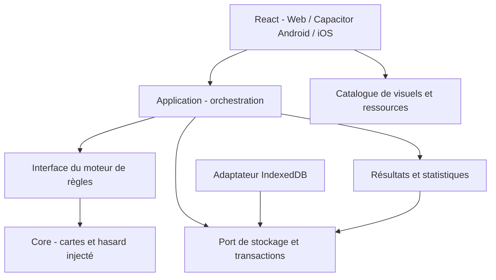

# Architecture Spine — CardForge

## Design Paradigm

**Architecture hexagonale légère + cœur fonctionnel déterministe.** Le domaine (cartes et règles de chaque jeu) est un noyau TypeScript sans effet de bord. La couche applicative orchestre les actions métier et dépend de ports de persistance. Les adaptateurs IndexedDB et les vues React/Capacitor dépendent du domaine et de l'application, jamais l'inverse.



## Invariants & Rules

### AD-01 — Web React + enveloppe mobile Capacitor [ADOPTED]
- **Binds:** interface, build, plugins de plateforme, livraison.
- **Prevents:** divergence du comportement métier entre trois applications.
- **Rule:** le Web React/Vite est la base fonctionnelle ; Android et iOS réutilisent les mêmes modules TypeScript et l'interface via Capacitor. Tout accès natif passe par un adaptateur. Pas de réécriture des moteurs pour mobile.

### AD-02 — Socle technique partagé, moteur autonome par jeu [ADOPTED]
- **Binds:** `src/core`, futurs `src/games/<game-id>`, contrat moteur.
- **Prevents:** moteur universel rempli d'exceptions ou logique partagée modifiant un jeu existant.
- **Rule:** chaque jeu expose son propre moteur, conforme à un contrat typé commun (création, actions légales, transition, issue). Le socle ne porte aucune règle spécifique à Clear the Dungeon.

### AD-03 — Transitions pures, états immuables et hasard maîtrisé [ADOPTED]
- **Binds:** tous moteurs, application, sauvegardes, tests.
- **Prevents:** résultats dépendant de l'UI, mutation accidentelle ou nouvelle pioche au chargement.
- **Rule:** `transition(state, action)` est pure et ne modifie jamais `state` ; état+action identiques donnent résultat identique. L'ordre initial de la pioche est déterminé à la création et inclus dans l'état sérialisé. Toute erreur métier laisse le dernier état valide inchangé.

### AD-04 — Port de stockage, adaptateur IndexedDB initial [ADOPTED]
- **Binds:** sauvegardes, préférences, statistiques, Web et WebViews.
- **Prevents:** dépendance du domaine à IndexedDB et implémentations contradictoires.
- **Rule:** les moteurs et l'application ne référencent pas directement `indexedDB` ; un port de persistance définit les écritures/lectures, la transaction unifiée sauvegarde-résultat, et la gestion d'échec. IndexedDB est l'adaptateur retenu pour le MVP, avec **tests de persistance et reprise obligatoires sur Web, Android, iOS** avant livraison. Une adaptation native future n'affecte pas le domaine.

### AD-05 — Carte logique indépendante du catalogue graphique [ADOPTED]
- **Binds:** données des cartes, visuels, mapping des factions.
- **Prevents:** changement des règles par une illustration ou une localisation.
- **Rule:** identité, enseigne et valeur d'une carte sont des données métier stables. Noms, illustrations, faction affichée, sons et animations sont résolus par identifiants dans un catalogue de présentation propre au jeu ; jamais consommés par le moteur de règles.

### AD-06 — Pyramide de tests liée aux règles [ADOPTED]
- **Binds:** moteurs, stockage, application, CI, diffusion.
- **Prevents:** jeu visuellement fonctionnel mais non conforme, régressions de reprise.
- **Rule:** scénarios déterministes pour chaque règle du référentiel, tests d'intégration des transactions/migrations, parcours de bout en bout sur Web et validation dédiée Android/iOS avant sortie. Les contrôles obligatoires échoués bloquent l'intégration/release ; une matrice non exécutée n'est pas une preuve de conformité.

### AD-07 — Ressources embarquées, répertoires par jeu [ADOPTED]
- **Binds:** assets, build, catalogue et mode hors ligne.
- **Prevents:** dépendance à un téléchargement de packs pour jouer au MVP.
- **Rule:** illustrations, sons, polices et textes nécessaires aux jeux livrés sont inclus dans la distribution Web/PWA et dans les paquets natifs. Pas de téléchargement de packs ni CDN obligatoire en V1. Regrouper les ressources par identifiant de jeu pour l'évolution future.

### AD-08 — PWA Web hors ligne, ressources mobiles embarquées [ADOPTED]
- **Binds:** service worker, cycle de vie, build Web, mobile.
- **Prevents:** promesse « hors ligne » fondée sur un cache opportuniste.
- **Rule:** le Web fournit un manifeste et un service worker à cache versionné ; ne déclarer le jeu prêt hors ligne qu'une fois toutes ses ressources requises disponibles. Android/iOS utilisent les ressources du paquet Capacitor. Cache de ressources et données persistées restent séparés ; une mise à jour des assets ne purge jamais volontairement les parties.

### AD-09 — Sauvegardes versionnées et migrations sans altération des règles [ADOPTED]
- **Binds:** enveloppes de sauvegarde, migrations, restauration.
- **Prevents:** destruction des parties lors d'évolution du code ou conversion silencieuse d'une règle.
- **Rule:** toute sauvegarde identifie au moins jeu, partie, version du format, version de règles et état complet ordonné. Une migration validée s'effectue transactionnellement avant remplacement de l'ancienne donnée. Une sauvegarde inconnue/incompatible est conservée et ne peut pas être reprise comme une partie valide. Version de l'application ≠ version de format ≠ version des règles.

### AD-10 — Orchestration unique hors React [ADOPTED]
- **Binds:** interface, transactions, compteurs, moteur.
- **Prevents:** actions validées différemment selon écran, double comptage, rendu d'un état non sauvegardé comme durable.
- **Rule:** le point d'entrée d'une action est un service applicatif unique par session ; il sérialise les commandes, appelle le moteur pur, persiste les changements et résultats une seule fois, puis notifie l'UI de l'état et du statut de persistance. L'interface ne calcule aucune victoire/défaite ; les événements terminaux possèdent un identifiant unique de partie/résultat pour une écriture idempotente.

### AD-11 — Erreurs catégorisées et récupération non destructive [ADOPTED]
- **Binds:** application, stockage, migrations et interface.
- **Prevents:** perte silencieuse des données, reprise d'état corrompu et confirmation mensongère.
- **Rule:** distinguer action invalide, écriture impossible, sauvegarde corrompue et migration incompatible. Ne jamais effacer automatiquement une sauvegarde invalide, ni afficher « Enregistré » avant confirmation de persistance. En cas d'échec, conserver si possible l'état courant en mémoire et permettre une reprise contrôlée ; ne promettre aucune récupération si le stockage physique a été supprimé.

### AD-12 — Builds mobiles en CI GitHub Actions [ADOPTED]
- **Binds:** workflows, runners, signatures, publication.
- **Prevents:** dépendance à un IDE local ou confusion entre build, signature et distribution.
- **Rule:** CI Web d'abord, puis Android sur runner compatible et iOS sur runner macOS compatible. Les secrets de signature ne sont jamais commités ; publication distincte du build technique, déclenchée et autorisée explicitement. Les contraintes actuelles GitHub/Capacitor/Apple restent à confirmer avant d'implémenter ces pipelines.

## Consistency Conventions

| Concern | Convention contraignante |
| --- | --- |
| Identités | `gameId` stable, `sessionId` distinct, `cardId` unique au sein du paquet ; résultats dédupliqués par identifiant stable de partie. |
| Contrat moteur | `create(seed/config)`, `transition(state,action)`, `availableActions(state)`, `getOutcome(state)` : noms de travail à fixer dans l'API TypeScript avant toute implémentation. |
| Résultats | `in-progress / win / loss / abandoned` ; abandon = commande confirmée, jamais fermeture d'onglet. |
| Persistance | Une sauvegarde active par `gameId`, statistiques indépendantes, état ordonné et versions explicites. |
| Écriture | Transitions métier synchrones ; persistance asynchrone confirmée ; commandes sérialisées, interdiction de double exécution ou écrasement concurrent. |
| Intégrité | Valider schéma, version et invariants avant restauration ; ne pas détruire une sauvegarde inconnue. |
| Cartes | Modèle neutre, catalogue visuel résolu côté UI ; aucune décision mécanique issue du thème. |
| Erreurs | Résultat typé du moteur, erreur technique catégorisée dans la couche applicative ; UI localisée, sans données sensibles dans les logs. |
| Accessibilité | Tactile et clavier, valeurs visibles indépendantes des couleurs, prise en charge de la réduction des animations. |

## Stack — relevé du dépôt, 22 novembre 2026

| Élément | État |
| --- | --- |
| React / react-dom | `^19.0.0` déclaré dans `package.json` |
| TypeScript | `~5.7.3` déclaré |
| Vite | `^6.0.0` déclaré |
| Tests | `node --test tests/*.test.mjs` présent ; test existant surtout textuel |
| Capacitor | **Adopté architecturalement, non installé ni version figée** |
| IndexedDB | API native Web/WebView, adaptateur à développer |
| PWA | Service worker et manifeste à développer |
| GitHub Actions | Pipelines mobiles à étudier et à configurer |

Les versions ci-dessus sont celles **déclarées par le dépôt**, pas un audit externe de leurs dernières versions. Aucune recherche Web avancée n'a été déclenchée pour ce document.

## Structural Seed

```text
src/
  core/            # cartes et tirage neutres — cards.ts existe
  games/           # un moteur pur par jeu — dossier à créer
  application/     # commandes, sessions, résultat, orchestration — à créer
  ports/           # contrats de persistance et de cycle de vie — à créer
  adapters/        # IndexedDB, puis capacités de plateforme — à créer
  presentation/    # mapping illustrations et univers visuels — à créer
  App.tsx          # catalogue React actuellement existant
tests/             # scénarios métier, intégration, parcours — à étendre
public/            # assets par jeu, manifeste et ressources Web — à organiser
.github/workflows/ # CI existante à inventorier avant adaptation
```

**État actuel :** le dépôt contient `src/core/cards.ts` et un catalogue React. Aucun moteur de Clear the Dungeon n'a encore été implémenté ; les répertoires suggérés ne doivent pas être présentés comme existants.

## Capability → Architecture Map

| Capacité | Composant propriétaire | AD |
| --- | --- | --- |
| Parties, actions et règles | `src/games/<game-id>` et `src/core` | AD-02, AD-03 |
| Catalogue et tutoriels | React et présentation | AD-01, AD-05 |
| Illustrations et sons | Ressources par jeu | AD-05, AD-07 |
| Sauvegarde exacte | Application + port + IndexedDB | AD-03, AD-04, AD-09, AD-11 |
| Abandon et compteurs | Application + transaction locale | AD-04, AD-10 |
| Réduction des animations | Présentation | AD-05, AD-07 |
| Hors ligne | PWA / bundles natifs | AD-01, AD-07, AD-08 |
| Tests de règles et parcours | Tests métier / intégration / E2E | AD-06 |
| Android et iOS | Capacitor + CI native | AD-01, AD-12 |

## Deferred / Gates

- **Moteur Clear the Dungeon :** ordre exact des phases, joker, épuisement de pioche et cas limites à confirmer d'après les règles primaires ; ne pas inventer d'arbitrage. Réserve facultative désactivée.
- **Droits :** accord gratuit déclaré par le porteur ; périmètre exact (Web, Android/iOS, nom, crédits) à conserver comme point de vérification avant publication.
- **Portabilité IndexedDB :** prototype réel Web + Android + iOS requis ; notamment persistance WebView après redémarrage, mise à jour, suspension, stockage saturé.
- **PWA :** choix de l'outil de service worker, stratégie de mise à jour et version des assets à définir en implémentation ; garantir qu'une version cohérente de ressources est disponible.
- **CI mobile :** compatibilité des runners macOS, quotas, certificats de signature Apple/Google, comptes éditeurs et coûts éventuels à vérifier avant pipeline ; pas de promesse de publication automatique.
- **Technologies à vérifier :** versions actuelles de Capacitor, plugins éventuels et support cible navigateur/WebView (recherche Web soumise à accord spécifique).
- **Déploiement Web :** hébergement, domaine, politique de cache et cadence de diffusion à choisir avant publication. Aucune API serveur nécessaire au solo MVP.
- **Observabilité :** erreurs locales explicites, pas de télémétrie obligatoire ni de collecte distante décidée ; définir un diagnostic respectueux de la vie privée si nécessaire.
- **Distribution :** Web/PWA en premier, builds mobiles ensuite ; matrice des appareils/support OS à valider.
- **Validation BMAD :** lint/independent reviewers natifs non exécutés : scripts `uv` non exécutables sur GitHub et absence d'exécution de sous-agents dans cette session. Relecture documentaire manuelle consignée dans `REVIEW.md`.

## Vérification des sources internes

- [Cadrage](../../../../docs/cadrage.md)
- [Product Brief](../../product-brief-cardforge.md)
- [Matrice Clear the Dungeon](../../clear-the-dungeon-rule-test-matrix.md)
- [Code source cartes](https://github.com/JeanLamora75/CardForge/blob/main/src/core/cards.ts)
- [Dépôt GitHub](https://github.com/JeanLamora75/CardForge)
